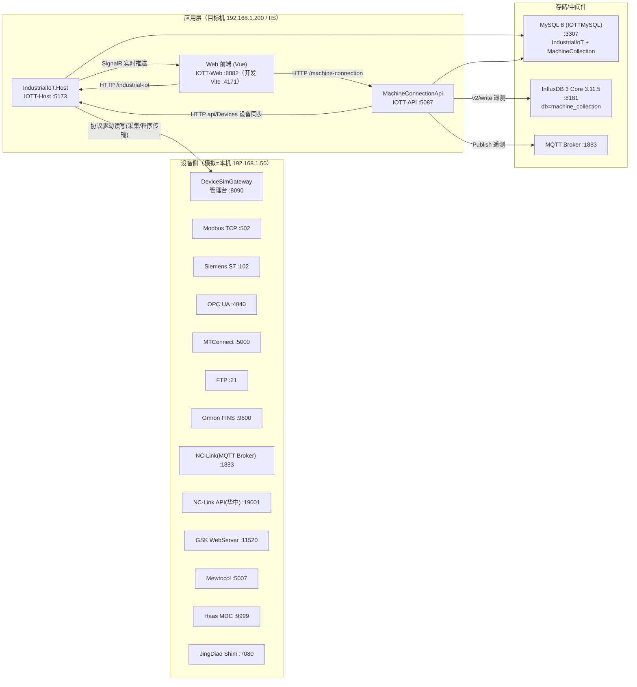
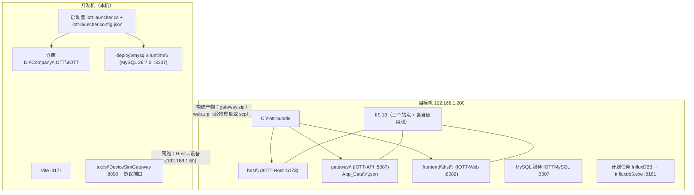
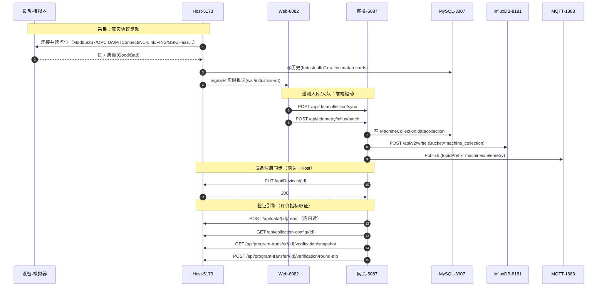
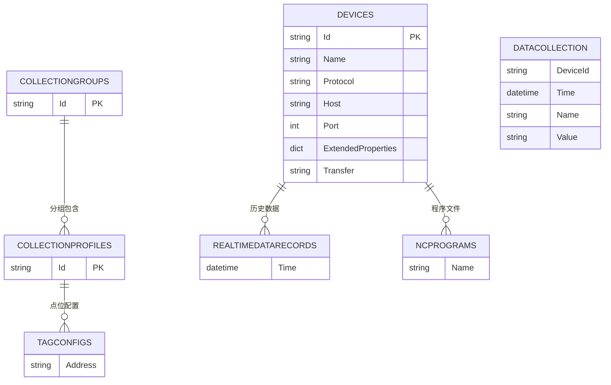
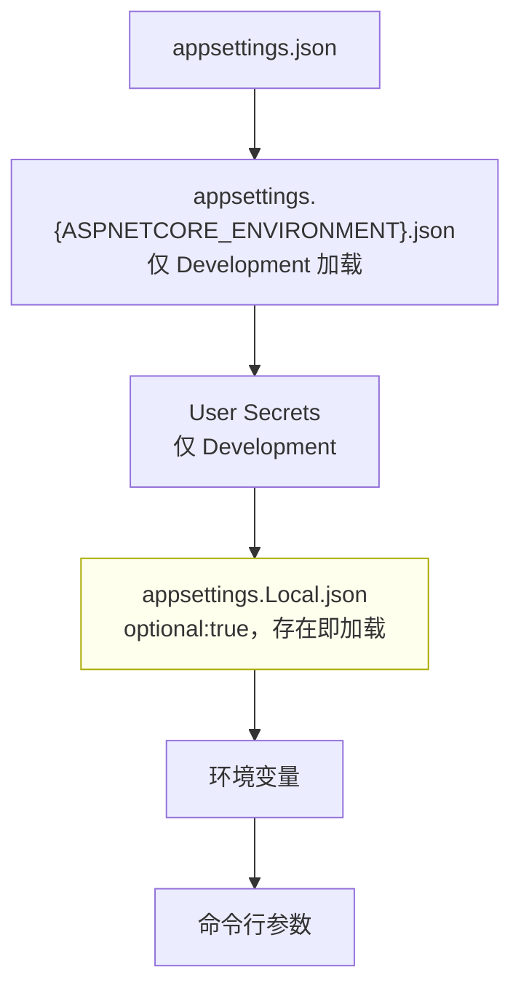
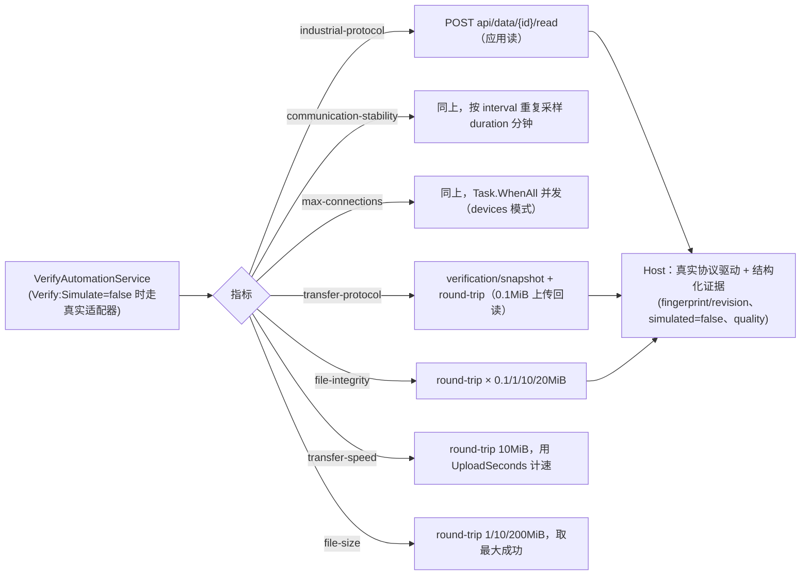

# IOTT 系统架构、配置与运作说明

- 版本/日期：2026-10-15
- 适用代码：`feature/compliance-fixes-20261010`
- 说明：文中"设备侧"以**本机的模拟设备网关（DeviceSimGateway）当作真实机床/PLC**来写；协议、端口、数据形态与真机一致。
- 目标环境：`192.168.1.200`（Windows 10 LTSC / IIS 10）；开发环境：本机（`dotnet run` + Vite + 启动器管理 MySQL）。
- 设备侧（模拟）：本机 `192.168.1.50`（DeviceSimGateway 多协议服务端）。

---

## 0. 一句话概览

四类进程 + 三种存储：**Host（工业数据采集/实时推送）** ↔ **设备（多协议）**；**API 网关（设备/评价/遥测/历史）** ↔ **Host**；**Web 前端（Vue SPA）** ↔ **网关与 Host**；存储为 **MySQL（业务/历史）**、**InfluxDB 3（时序遥测）**、**MQTT（消息）**，另有大量 **JSON 文件存储**（网关 `App_Data`）。

---

## 1. 组件与端口

**端口清单**

| 端口 | 组件 | 说明 |
|---|---|---|
| 5173 | Host | IIS 站点 `IOTT-Host`；开发为 `http://localhost:5173` |
| 5087 | 网关 | IIS 站点 `IOTT-API` |
| 8082 | 前端 | IIS 站点 `IOTT-Web`（静态 `dist` + `web.config` 反代） |
| 4171 | 前端(开发) | Vite dev server，代理 `/machine-connection`→5087、`/industrial-iot`→5173(ws) |
| 3307 | MySQL | 实例 `IOTTMySQL`（目标机）；开发机由启动器管理 `.runtime` |
| 3306 | MySQL | 目标机另有 `MySQL80`（项目未使用）；开发机有机器级 `MySQL` |
| 8181 | InfluxDB 3 Core | 计划任务 `InfluxDB3` 拉起，`--object-store file --data-dir C:\lhb\influxdb3-data` |
| 1883 | MQTT | 目标机未运行（见 §9）；设备侧由模拟器内置 Broker |
| 8090 | 模拟器管理台 | `GET/PUT /api/services|/api/generator|/api/failure`，`GET /api/ports|/api/doc` |
| 502/102/4840/5000/21/9600/1883/19001/11520/5007/9999/7080 | 模拟器 | 分别对应 Modbus / S7 / OPC UA / MTConnect / FTP / FINS / NC-Link / NC-Link API / GSK / Mewtocol / Haas / 精雕 |

---

## 2. 部署视图

要点：
- **配置以 `appsettings.Local.json` 为准**（见 §5），目标机的关键项（连接串、`Verify:Simulate`、InfluxDB Token）都写在该文件里，重新发布 `appsettings.json` 不会覆盖它。
- 部署包 = `host/ + gateway/ + frontend/dist/`；IIS 三个站点分别指向三者。

---

## 3. 运行时数据流

数据归属小结：
- **采集/实时**：Host ↔ 设备；实时经 **SignalR(ws)** 到前端；历史落 Host 的 MySQL。
- **遥测时序**：由**前端**把批次送到网关（`/api/datacollection/sync`、`/api/telemetry/influx/batch`），网关写 **InfluxDB** 与 **MQTT**，并落网关 MySQL。
- **设备清单**：网关为写入端，向 Host 同步（`api/Devices`）。
- **验证/评价**：网关是执行者，Host 只提供"已实现好的"读/目录/传输接口与结构化证据。

---

## 4. 存储与数据模型

### 4.1 MySQL（实例 :3307，用户 `iott`）

- 库 `IndustrialIoT`（Host）：`devices`、`tagconfigs`、`collectionprofiles`、`collectiongroups`、`realtimedatarecords`、`ncprograms`。
- 库 `MachineCollection`（网关）：`datacollection`。
- 注：实体间连线为**逻辑关系推断**（按命名），非数据库外键约束。

### 4.2 InfluxDB 3 Core（:8181）

| 项 | 值 |
|---|---|
| URL | `http://127.0.0.1:8181` |
| 数据库(bucket) | `machine_collection` |
| Measurement | `datapoint` |
| Org | `default` |
| 写入接口 | `POST /api/v2/write?org=default&bucket=machine_collection`（兼容 v2），Header `Authorization: Token/Bearer <token>` |
| 查询接口 | `POST /api/v3/query_sql` `{db,q,format:"json"}` |
| 鉴权 | 强制；本机由计划任务 `InfluxDB3` 启动（**未传 `--auth-token`**，首次启动生成并持久化） |

### 4.3 JSON 文件存储（网关 `App_Data`，主机本身也用 JSON 存一部分）

| 文件 | 内容 |
|---|---|
| `verify-tasks.json` | 验证/评价任务及最近一次运行结果（`lastRunJson`） |
| `verify-task-completions.json` | 待回写完成的运行结果（崩溃恢复用） |
| `evaluation-indicators.json` | 评价指标树 + 自动测试规则（7 项通讯指标） |
| `evaluation-records.json` | 评价知识记录 |
| `evaluation-attachments\` | 文件传输验证附件（`<id>.bin` + `<id>.json`） |
| `devices.json` / `system-logs.json` 等 | 设备与系统日志等 |

---

## 5. 配置体系

### 5.1 加载顺序与优先级

- 代码位置：Host `Program.cs:17-20`、网关 `Program.cs:9-13`（都在 `CreateBuilder` 之后**追加** `appsettings.Local.json`，随后再加一次环境变量与命令行）。
- **同键优先级（后胜）**：`appsettings.json` < `appsettings.Development.json`(仅 Development) < `appsettings.Local.json` < 环境变量 < 命令行。
- 目标机 IIS 未设 `ASPNETCORE_ENVIRONMENT` → 默认 `Production` → **不加载 `appsettings.Development.json`**；一切以 `appsettings.Local.json` 为准。
- 热重载：Host 的 Local `reloadOnChange:true`，网关为 `false`（改后需重启）。

### 5.2 关键配置项

**Host（`Host/src/IndustrialIoT.Host/appsettings*.json`）**

| 键 | 目标机取值 | 说明 |
|---|---|---|
| `ConnectionStrings:Default` | `Server=127.0.0.1;Port=3307;Database=IndustrialIoT;User ID=iott;Password=***;DateTimeKind=Utc;` | MySQL |
| `Database:ServerVersion` | 8.0.35 | MySQL 版本（开发机 8.4.0） |
| `Urls` | `http://localhost:5173` | 监听 |
| Serilog 级别 | Default=Information；AspNetCore/EfCore=Warning | 日志（输出到 `logs/`） |
| `Gskrm:Mode` / `IpcBaseUrl` | `Ipc` / `http://127.0.0.1:39123` | 广数 Gskrm 走 IPC shim |
| `DataOutput:Mqtt:*` | BrokerHost `localhost`、Port `1883`、Topic `industrial-iot/devices/{deviceId}/data` | Host 的 MQTT 输出（目标机 1883 未起） |

**网关（`MachineConnectionApi…/appsettings*.json`）**

| 键 | 目标机取值 | 说明 |
|---|---|---|
| `ConnectionStrings:MachineCollection` | `Server=127.0.0.1;Port=3307;Database=MachineCollection;User ID=iott;Password=***` | 注意默认 `appsettings.json` 是 3306，靠 Local 改 3307 |
| `IndustrialIoT:BaseUrl` | `http://localhost:5173` | 上游 Host |
| `IndustrialIoT:*Path` | `api/Devices`、`api/data`、`api/collection-config`、`api/program-transfer`… | 调 Host 的路径 |
| `Verify:Simulate` | **false** | 是否用模拟测量适配器（false=真实取证） |
| `Mqtt:*` | Host `127.0.0.1`、Port 1883、Prefix `machines/telemetry` | 遥测 MQTT 转发 |
| `InfluxDB:*` | Url `http://127.0.0.1:8181`、Bucket `machine_collection`、Measurement `datapoint`、Org `default`、**Token（Local 覆盖）** | 时序库 |
| `Database:ServerVersion` | 8.0.35 | |

**前端（`code20260423/code`）**

| 键 | 值 |
|---|---|
| `server.port` | 4171 |
| `VITE_MACHINE_CONNECTION_PROXY_TARGET` | `http://localhost:5087`（路径 `/machine-connection`，去掉前缀） |
| `VITE_INDUSTRIAL_IOT_PROXY_TARGET` | `http://localhost:5173`（路径 `/industrial-iot`，**ws:true** 供 SignalR） |

**启动器（开发机 `iott-launcher.config.json`，gitignore）**

| 段 | 关键项 |
|---|---|
| 运行 | HostPort 5173、GatewayPort 5087、FrontendPort 4171、MySqlPort 3307、MockPort 5199、InfluxPort 8181 |
| 选项 | UseMock、GatewayUseMock、UseInflux、SkipMySql/SkipFrontend/Force/NoBuild/Background、**VerifySimulate** |
| MySQL | DataDir `deploy/mysql/.runtime/data`、ServerVersion 8.4.0、AppUser iott、Database1/2 |
| Host/Gateway/Frontend/InfluxDB | 对应各 `ConnectionStrings.*`、`Urls`、代理与端口等 |

**模拟器（`tools/DeviceSimGateway`）**：`sim-config.json`（各服务端口/开关、`Generator`：Holding/Input/Coils/Discrete 规模与波形、**随机失败注入** `FailureEnabled/FailureRatePercent/FailureDropConnection`）；运行期文件位于 `bin/` 下。

---

## 6. 验证引擎（网关侧 7 项通讯指标）

- 测量一律走 **Host 已实现的接口**，且要求**结构化应用读/往返证据**（TCP 握手不算证据，模拟数据会被拒）。
- 文件类走**验证专用**接口（原子独占创建 + 上传 + SHA256 回读 + 清理），不是通用上传下载。
- 评价配置（指标树/规则/达标线）在 `evaluation-indicators.json`，可在"评价指标管理"中维护。

---

## 7. 协议与设备接入（驱动 ↔ 模拟服务端）

| 设备协议(驱动) | 模拟服务端端口 | 说明 |
|---|---|---|
| Modbus TCP | 502 | FC01/02/03/04/05/06/0F/10 |
| Siemens S7 | 102 | S7comm/ISO-TSAP（DB/M/I/Q） |
| OPC UA | 4840 | 匿名/None，节点 `ns=1;s=Sim.X/Y/Z/Spindle/Feed/PartCount` |
| MTConnect | 5000 | `/probe`、`/current` |
| FTP | 21 | 程序库列表/上传/下载/删除 |
| Omron FINS | 9600 | FINS/TCP |
| NC-Link(MQTT) | 1883 | 内置 Broker，guid `sim-device-001` |
| NC-Link API(华中) | 19001 | HTTP `/v1/{deviceId}/data|file/` |
| GSK WebServer | 11520 | `/api/v1/...` + `/ws/...` |
| Mewtocol | 5007 | ASCII + BCC |
| Haas MDC | 9999 | TCP ASCII |
| JingDiao Shim | 7080 | HTTP `/api/jingdiao/*` |

文件传输协议（验证口径）**仅 FTP/SMB/NFS** 被 Host 认可为"可验证"（`SupportsSafeProtocol`）；模拟器目前实现 **FTP**（无 SMB/NFS 服务端）。

---

## 8. 启动与运维

| 项 | 目标机 | 开发机 |
|---|---|---|
| Host/网关 | IIS 站点 `IOTT-Host`/`IOTT-API`（应用池同名） | `dotnet run` 或启动器 |
| 前端 | IIS 站点 `IOTT-Web`（静态 `dist` + `web.config`） | `npm run dev`（Vite 4171） |
| MySQL | 服务 `IOTTMySQL`（:3307，自启） | 启动器管理 `deploy/mysql/.runtime`（:3307） |
| InfluxDB | 计划任务 `InfluxDB3` → `influxdb3.exe serve`（:8181） | 启动器/Docker（compose.yaml） |
| 设备侧 | — | `dotnet run --project tools/DeviceSimGateway`（:8090 + 协议端口） |

**部署**：`gateway.zip` + `web.zip` 经物理盘（`I:\iott-deploy` → 目标机 `D:\iott-deploy`）或 scp；`apply-deploy.ps1` 停站点/应用池 → 解压 → `robocopy /MIR`（保留 `App_Data`/`logs`/`web.config`/`appsettings.Local.json`）→ 启动 → 校验。

**排障入口**：
- 网关日志 `C:\iott-bundle\gateway\logs\stdout_*.log`；Host 日志 `C:\iott-bundle\host\logs\industrial-iot-*.log`。
- 模拟器 `http://192.168.1.50:8090`（服务状态/数据生成/随机失败注入）。
- MySQL：`mysql -h127.0.0.1 -P3307 -uiott -p`；导出 `mysqldump`（见 §4.1）。

---

## 9. 已知问题与注意（运维相关）

1. **InfluxDB 鉴权**：运行实例只认计划任务首次生成并持久化的 token（用户记录于 `C:\Users\ktb\Desktop\Info.txt`，`apiv3_1Ama…`）；网关原先配置的是另一个 `apiv3_103U…` → 写入 401。**已修**：在网关 `appsettings.Local.json` 用 `InfluxDB.Token` 覆盖为正确 token 并重启应用池；实测 `/api/telemetry/influx/batch` 返回 `{"written":1}`、`datapoint` 计数 +1。建议给 `InfluxDB3` 任务补 `--auth-token` 以固定 token，并同步修正 `appsettings.json` 里的旧值。
2. **MQTT(1883) 未运行**：网关/Host 的 MQTT 输出目标是 `127.0.0.1:1883`，目标机上无 Broker → 遥测的 MQTT 环节会报连接失败（不影响 InfluxDB/MySQL）。
3. **Host 请求体上限**：200MiB 文件往返会被 IIS 默认 `maxAllowedContentLength`(≈30MB) 拒绝（404.13）→ `file-size` 指标判未评分。需在 Host 站点 `web.config` 提升 `requestFiltering/requestLimits`。
4. **验证指标若干逻辑问题**：见同目录 `VERIFY_METRICS_LOGIC_AUDIT_20261015.md`（死参数、超时整项作废、single-device 并发未实现、transfer-protocol 全有或全无等）。
5. **SMB/NFS 未模拟**：样例设备中 `transfer=SMB` 的在本机无法做真实文件传输验证（Host 支持，属模拟器缺口）。
6. **配置不一致**：开发机 `iott-launcher.config.json` 里的 Host/Gateway 连接串仍是旧密码 `3ce399…`，与 `.runtime/instance.json`、`appsettings.Local.json` 的 `917a5357…` 不同；用启动器"应用"会覆盖成旧密码，建议同步。
